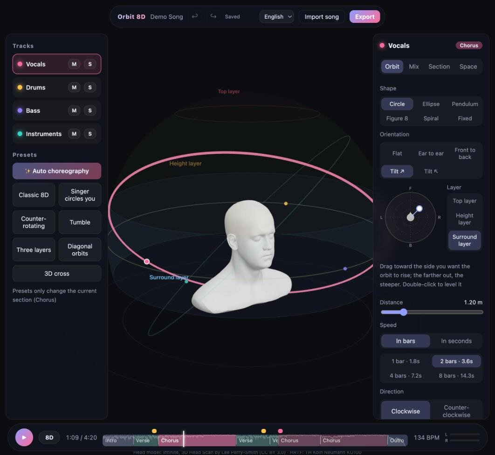

# Orbit 8D

**Turn any song into customizable 8D (binaural) audio — on your own computer.**
Orbit 8D splits a song into vocals, drums, bass and other instruments, places each part in 3D space around a virtual head, and moves it along orbits you can shape. You hear the result live in the browser and export it to M4A, MP3, FLAC, WAV or OGG.



> **Use headphones.** 8D audio relies on each ear hearing something different. On speakers it just sounds like ordinary stereo.

## Highlights

- **Real binaural rendering.** Sound positions are rendered with a measured human-head response (Neumann KU100 HRTF, 2° grid over the whole sphere), so you get real timing, level and ear-shape cues, not just left–right panning.
- **Stem-aware.** Each instrument group moves on its own orbit. Deep bass (below 120 Hz) always stays in front, so the low end never lurches from ear to ear.
- **Auto choreography.** The app finds the intro, verses, choruses, bridge and outro, and gives each section its own motion: a slow raised spiral for the intro, fast opposite diagonals for the chorus, a vertical cross for the bridge, a fly-over at the biggest chorus and a short hold inside long verses. Repeated sections get a different move each time, and ✨ re-choreographs your own section layout. Every section stays editable.
- **Hands-on 3D editor.** Choose from six orbit shapes, tilt an orbit in any direction, lift it to the height or top layer, change distance, speed and direction, and drag section boundaries and events on a timeline.
- **Faithful sound.** A scene-aware tone correction keeps the timbre close to the original song, and gentle mastering keeps the dynamics. Press **B** at any time to switch between 8D and the original at matched loudness.
- **What you hear is what you export.** The browser preview uses the same algorithm and data as the high-quality export.
- **Private.** Everything runs locally. The server only listens on `127.0.0.1`; your music never leaves your machine.
- **Three languages.** The interface is available in English, 中文 and 日本語.

## Requirements

| | |
|---|---|
| Operating system | macOS on Apple Silicon (tested; stem separation runs on the GPU). Linux with an NVIDIA GPU or on CPU should work but is untested — CPU separation takes roughly 2.5× the song length. |
| Tools | [uv](https://docs.astral.sh/uv/) (Python manager), [Node.js](https://nodejs.org/) 20 or newer, [ffmpeg](https://ffmpeg.org/) (`brew install ffmpeg`), `make` and `git` |
| Browser | A current Chrome, Edge, Safari or Firefox |
| Disk space | About 2 GB for dependencies and models, plus about 300 MB per imported song |
| Memory | 8 GB is enough — analysing or exporting a 4-minute song uses about 1 GB, and even a 20-minute song stays under 3 GB |

## Install

```bash
git clone https://github.com/Eureka0w0v0/orbit8d.git
cd orbit8d
make setup
```

`make setup` installs Python 3.12 and the backend dependencies (including PyTorch and Demucs) with uv, installs the web dependencies with npm, and downloads the HRTF data set (about 20 MB) and the Demucs separation model (about 340 MB; skipped if it is already in your Hugging Face cache). Every file is checked against a SHA-256 hash.

## Run

```bash
make run
```

This builds the web interface, starts the local server and opens **http://127.0.0.1:8765** in your browser. Stop it with <kbd>Ctrl</kbd>+<kbd>C</kbd>.

If the separation model could not be downloaded during setup, the first import downloads it (about 340 MB, with a progress bar). After that Orbit 8D works offline.

## Quick start

1. **Import.** Drag a song onto the window, or click to choose a file. Orbit 8D decodes it, separates the stems (about a third of the song's length on Apple Silicon), then analyses tempo and sections. Songs you imported before are listed under the drop area and under **▾** next to the song title, where you can reopen or delete them.
2. **Listen.** Put on headphones and press <kbd>Space</kbd>. The song opens with its auto choreography; the coloured dots show where each part is.
3. **Compare.** Press <kbd>B</kbd> to hear the original, and <kbd>B</kbd> again to return to 8D.
4. **Adjust (optional).** Click the timeline to jump to a section, then change that section's orbits in the right-hand panel. Changes save automatically, and <kbd>⌘</kbd>/<kbd>Ctrl</kbd>+<kbd>Z</kbd> undoes them.
5. **Export.** Click **Export**, pick a format and a loudness (**Loud** matches the preview, **Standard** is −14 LUFS for long listening) and download `Artist - Title (8D).m4a`. Title, artist and album are kept, and M4A, MP3 and FLAC also keep the cover art.

The [User Guide](docs/USER_GUIDE.md) walks through every panel and button.

## Keyboard shortcuts

| Key | Action |
|---|---|
| <kbd>Space</kbd> | Play / pause |
| <kbd>←</kbd> / <kbd>→</kbd> | Jump back / forward 5 seconds |
| <kbd>B</kbd> | Switch between 8D and the original |
| <kbd>⌘</kbd>/<kbd>Ctrl</kbd>+<kbd>Z</kbd> | Undo |
| <kbd>⇧</kbd>+<kbd>⌘</kbd>/<kbd>Ctrl</kbd>+<kbd>Z</kbd> or <kbd>Ctrl</kbd>+<kbd>Y</kbd> | Redo |
| <kbd>Delete</kbd> / <kbd>Backspace</kbd> | Delete the selected event |
| <kbd>Esc</kbd> | Deselect the event |
| Hold <kbd>⌥</kbd>/<kbd>Alt</kbd> while dragging an event | Place it freely instead of snapping to beats |

## Documentation

- **[User Guide](docs/USER_GUIDE.md)** — how to use every part of the app, with screenshots.
- **[How It Works](docs/HOW_IT_WORKS.md)** — what happens from import to export: stem separation, tempo and section detection, the timeline, binaural rendering, reverb, tone correction and mastering.
- **[Technical specification](docs/SPEC.md)** (Chinese) — the engineering reference: formulas, parameter ranges, API, state machines and test design.

## Configuration

Settings are read from environment variables when the server starts:

| Variable | Default | Meaning |
|---|---|---|
| `ORBIT8D_PORT` | `8765` | Port of the local server |
| `ORBIT8D_DATA_DIR` | `./data` | Where songs, stems, exports and logs are stored |
| `ORBIT8D_MAX_UPLOAD_MB` | `300` | Largest file you can import |
| `ORBIT8D_MAX_DURATION_S` | `1200` | Longest song you can import (seconds) |

The server always binds to `127.0.0.1`; there is deliberately no option to expose it to the network.

## Your data

Everything lives in the `data/` folder of the project (or in `ORBIT8D_DATA_DIR`):

- `data/projects/<id>/` — one folder per song: a copy of the file you imported, the four stems (24-bit FLAC), the preview files, the analysis and your saved scene. The id is derived from the file's content, so importing the same file again opens the existing project instantly.
- `data/exports/` — rendered exports.
- `data/assets/` — the HRTF data and, if it was not already in your Hugging Face cache, the Demucs model.
- `data/logs/orbit8d.log` — the server log (structured JSON), useful when something goes wrong.

To remove a song, delete it from the recent-songs list (click **Delete** twice); this also removes its exports and never touches the original file on your computer. A song that is still being processed cannot be deleted until it finishes. Projects created by older versions are converted to the smaller FLAC storage once at startup.

## Troubleshooting

| Problem | What to do |
|---|---|
| It sounds like normal stereo | Use headphones, not speakers. Check that the button next to Play says **8D**, not **Original**. |
| "ffmpeg was not found" | Install ffmpeg (`brew install ffmpeg`) and restart the server. |
| "Cannot reach the local service" | The server is not running. Start it with `make run` and reload the page. |
| Port 8765 is already in use | Start with another port: `ORBIT8D_PORT=8876 make run`. |
| A song stays in "Separating stems" for a long time | Without an Apple Silicon or NVIDIA GPU, separation runs on the CPU and takes about 2.5× the song length. The very first import may download the model first; the progress screen says so. |
| "Could not download the separation model" | Check your internet connection and import the song again, or run `make assets` to download the model in the terminal. |
| An older song shows "analysing" after an update | When the analysis format changes, projects are re-analysed once at startup (the stems are kept). This takes about 15 seconds per song. |

More answers are in the [User Guide](docs/USER_GUIDE.md#troubleshooting).

## Development

```bash
make dev    # backend on 127.0.0.1:8765 + Vite dev server on 127.0.0.1:5173 with hot reload
make test   # Python and TypeScript test suites
make lint   # ruff check and format check
```

```
backend/orbit8d/
  engine/     orbit formulas, timeline, HRTF, block renderer, reverb, mastering, tone correction,
              tempo, section detection, auto choreography, scene model, full-song pipeline,
              segment-by-segment processing (bounded memory)
  media/      ffmpeg wrapper (input whitelist, encoding, cover art), chunked audio file I/O
  separate/   Demucs stem separation and model download
  jobs/       explicit state machines, record store, job queue
  api/        HTTP API
web/src/
  orbit/      orbit formulas and timeline (the TypeScript twin of the Python code)
  audio/      real-time binaural core, AudioWorklet, preview engine
  scene/      Three.js stage, head model, orbit views, drag handles, scene editing
  ui/         panels, timeline and widgets
  i18n/       English / Chinese / Japanese strings
shared/golden/  cross-language test data (generated by Python, checked by TypeScript)
```

The Python and TypeScript versions of the orbit formulas, the timeline and the block renderer are kept in lock-step by shared "golden" test data: positions must match within 10⁻⁹ and rendered audio within −90 dB.

## Credits and licenses

- Head model: "Infinite, 3D Head Scan" by Lee Perry-Smith, [CC BY 3.0](https://creativecommons.org/licenses/by/3.0/) (`web/public/models/LeePerrySmith_License.txt`), taken from the three.js examples.
- HRTF: TH Köln, "A Spherical Far Field HRIR/HRTF Compilation of the Neumann KU 100" (B. Bernschütz), CC BY-SA 3.0. It is not included in this repository; `make setup` downloads it from sofacoustics.org.
- Stem separation: [Demucs](https://github.com/facebookresearch/demucs) (MIT).
- 3D rendering: [three.js](https://threejs.org/) (MIT).

Orbit 8D itself is released under the [MIT License](LICENSE). The third-party assets above keep their own licenses; the HRTF data set and the Demucs model weights are downloaded separately and are not part of this repository.
